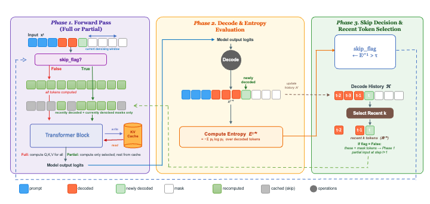

# EntropyCache: Decoded Token Entropy Guided KV Caching for Diffusion Language Models

<p align="center">
<a href="https://arxiv.org/abs/2603.18489"></a>
</p>

<p align="center">
  
</p>

## Setup
```bash
# Create and activate the environment
conda create -n entropycache python=3.11 -y
conda activate entropycache

# Install dependencies
pip install -r requirements/common.txt

# Prepare the dotenv file, and set model paths if needed
cp .env.example .env
```

## Evaluation

Evaluation runs through [`eval.py`](./eval.py) (Hydra + [lm-evaluation-harness](https://github.com/EleutherAI/lm-evaluation-harness)). Example scripts that run EntropyCache and the baselines:

```bash
# GSM8K, MATH-500, MBPP, HumanEval
bash scripts/run_eval_basic.sh

# GSM8K (CoT), GPQA, MMLU-Pro, BBH
bash scripts/run_eval_cot.sh
```

A single EntropyCache run looks like this:

```bash
accelerate launch eval.py \
    model=llada-inst \
    dataset.name=gsm8k \
    batch_size=1 \
    cache=entropy \
    cache.entropy_threshold=1.5 \
    cache.k_recent_keep=64 \
    generation=sliding_window \
    generation.window_size=32 \
    generation.threshold=0.9
```

**Models** (`model=`)
- `llada-base`: GSAI-ML/LLaDA-8B-Base
- `llada-inst`: GSAI-ML/LLaDA-8B-Instruct
- `dream-base`: Dream-org/Dream-v0-Base-7B
- `dream-inst`: Dream-org/Dream-v0-Instruct-7B

**Cache methods** (`cache=`)
- `entropy`: EntropyCache (ours)
- `prefix`: Fast-dLLM (use `cache.use_dual=true` for dual cache)
- `dllm`: dLLM-Cache
- `d2cache`: d²Cache
- `elasticcache`: Elastic-Cache
- no cache (default)

**EntropyCache options** ([`configs/cache/entropy.yaml`](./configs/cache/entropy.yaml))
- `entropy_threshold`: a full KV recomputation is triggered at the next step if any newly decoded token has entropy above this threshold; otherwise it is skipped.
- `k_recent_keep`: number of most recently decoded tokens that are still recomputed (together with the masked tokens) on steps where full recomputation is skipped.

Other generation arguments can be set in `configs/generation/*.yaml` or `configs/gen_args.py`. If you hit errors in code evaluation (HumanEval/MBPP), run [`scripts/fix_code_eval.sh`](./scripts/fix_code_eval.sh).

## Acknowledgments
We would like to express our gratitude to the previous studies on DLLM KV caching that inspired our work. Special thanks to the authors of [d2Cache](https://github.com/Kamichanw/d2Cache#) for providing excellent open-source code, which served as a valuable foundation for our experimental framework. We also acknowledge the developers of LLADA and Dream for making their models publicly available, which were instrumental in our experiments.

## Citation

If you find this work useful, please cite our paper:

```bibtex
@article{cheong2026entropycache,
  title={EntropyCache: Decoded Token Entropy Guided KV Caching for Diffusion Language Models},
  author={Cheong, Minsoo and Son, Donghyun and Lim, Woosang and Yoo, Sungjoo},
  journal={arXiv preprint arXiv:2603.18489},
  year={2026}
}
```
